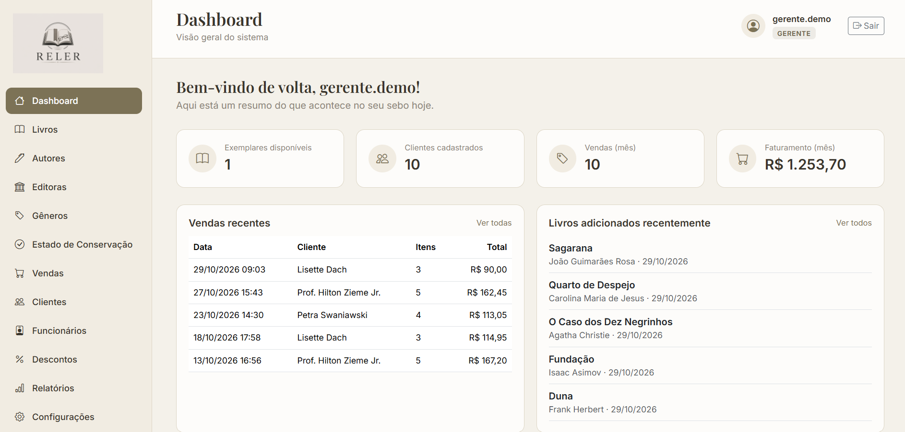
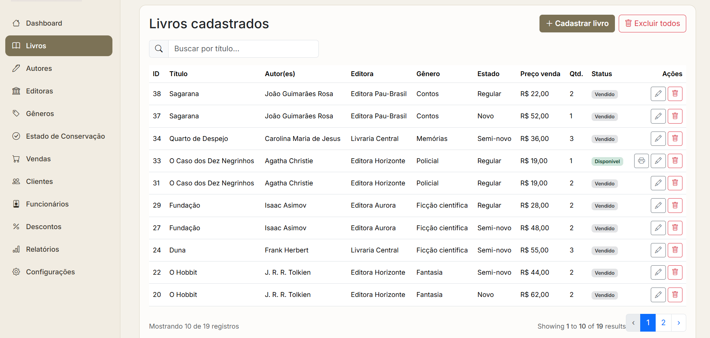
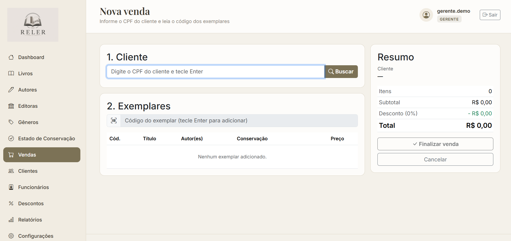
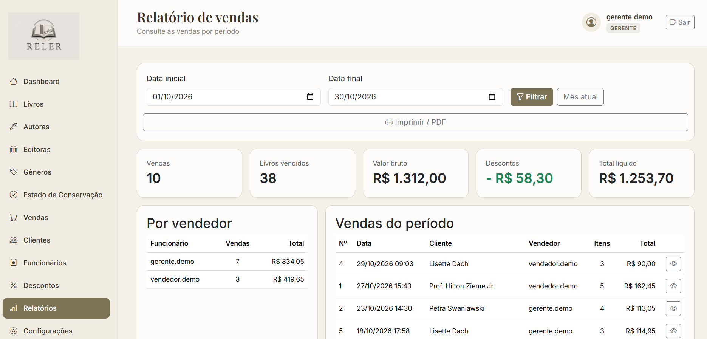
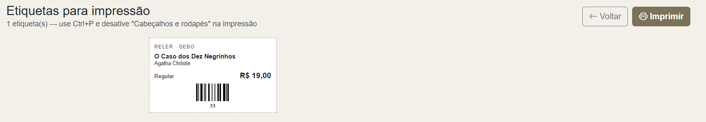
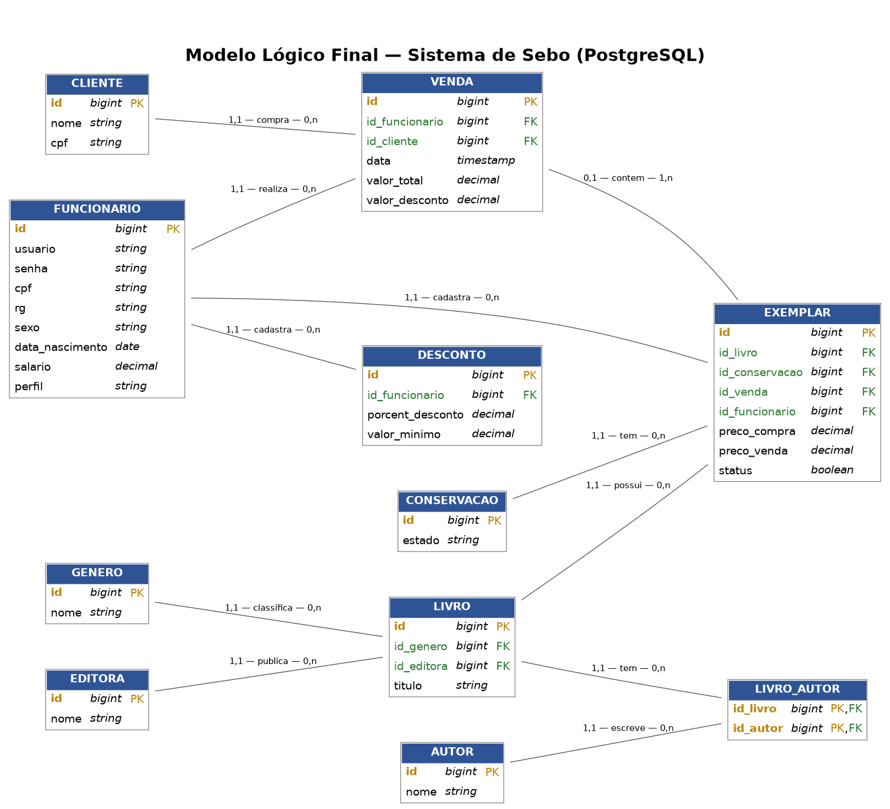

# Reler


Sistema web para gerenciar um **sebo** (livraria de livros usados): cadastro de livros e exemplares, clientes e funcionários, vendas com **desconto automático por faixa de valor** e relatório de vendas por período. Projeto de estudo desenvolvido para praticar **Laravel, PostgreSQL e testes automatizados**.

## Funcionalidades

**Para vendedores e gerentes**
- Login com perfis de acesso (`GERENTE` e `VENDEDOR`)
- **Dashboard** com exemplares disponíveis, clientes, vendas e faturamento do mês, vendas e livros recentes
- **Livros e exemplares**: cadastro de um livro com várias cópias de uma vez, múltiplos autores, estado de conservação, preço de compra e de venda. A listagem agrupa as cópias iguais (mesmo livro, estado e preço) em uma única linha com a quantidade
- **Etiquetas com código de barras** (Code 128) para colar nos exemplares, prontas para imprimir
- **Venda estilo caixa**: busca o cliente pelo CPF e adiciona exemplares pelo código (digitado ou lido por leitor de código de barras), com o total e o desconto calculados na hora
- Cadastros de **clientes**, **autores**, **editoras**, **gêneros** e **estados de conservação**

**Exclusivo do gerente**
- Cadastro de **funcionários**
- Edição das **faixas de desconto**
- **Relatório de vendas por período**, com total por vendedor e versão para imprimir ou salvar em PDF

## Regras de negócio

- Um exemplar vendido fica **indisponível** automaticamente (trigger no banco)
- **Desconto automático** sobre o total da venda (faixas editáveis pelo gerente):

| Total da venda | Desconto |
|---|---|
| Acima de R$ 100,00 | 5% |
| Acima de R$ 250,00 | 10% |
| Acima de R$ 500,00 | 15% |

- Vale a maior faixa atingida; exatamente no valor limite **não** conta ("acima de")
- Apenas o gerente cadastra funcionários, altera descontos e emite o relatório
- Uma venda é um registro histórico: não pode ser editada nem excluída

## Telas

> Capturas feitas com os dados do `DemoSeeder`.

| Dashboard | Listagem de livros |
|---|---|
|  |  |

| Nova venda | Relatório de vendas |
|---|---|
|  |  |

| Etiquetas | Login |
|---|---|
|  |  |

## Tecnologias

- [Laravel 13](https://laravel.com/) (PHP 8.3+, testado com 8.4)
- [PostgreSQL](https://www.postgresql.org/) (restrições `CHECK`, trigger em PL/pgSQL)
- [Bootstrap 5](https://getbootstrap.com/) + [Bootstrap Icons](https://icons.getbootstrap.com/)
- [Vite](https://vitejs.dev/) para compilar os assets
- Blade (templates) e JavaScript puro (`fetch`) nas partes dinâmicas
- [JsBarcode](https://github.com/lindell/JsBarcode) para os códigos de barras
- PHPUnit (testes) e GitHub Actions (CI)

## Modelo de dados



Principais tabelas: `livro`, `exemplar` (cada cópia física, com preço, estado e status), `autor` (N:N com livro), `editora`, `genero`, `conservacao`, `cliente`, `funcionario`, `venda` e `desconto`.

- Chaves estrangeiras com `RESTRICT` para preservar o histórico
- Valores monetários em `NUMERIC(10,2)`
- Restrições `CHECK` (perfil válido, valores não negativos, coerência entre `status` e `id_venda`)
- **Trigger** que marca o exemplar como vendido ao receber o `id_venda`

## Instalação

### Pré-requisitos

- PHP 8.3 ou superior, com as extensões `pdo_pgsql` e `pgsql`
- Composer
- PostgreSQL
- Node.js 20+ e npm

### Passo a passo

```bash

# Clonar o repositório
git clone https://github.com/WesleyVinicius/sebo-reler.git
cd sebo-reler

# Dependências
composer install
npm install

# Ambiente
cp .env.example .env
php artisan key:generate
```

Edite o `.env` com os dados do seu PostgreSQL:

```env
DB_CONNECTION=pgsql
DB_HOST=127.0.0.1
DB_PORT=5432
DB_DATABASE=sebo_reler
DB_USERNAME=postgres
DB_PASSWORD=sua_senha
```

Crie o banco e rode as migrations:

```sql
CREATE DATABASE sebo_reler;
```

```bash

php artisan migrate
```

### Dados de demonstração (opcional)

```bash

php artisan db:seed --class=DemoSeeder
```

Cria 2 funcionários, as faixas de desconto, 12 livros com exemplares, 10 clientes e 10 vendas de exemplo. Pode ser executado mais de uma vez sem duplicar os dados. O seeder não roda em ambiente de produção.

| Perfil | Usuário | Senha |
|---|---|---|
| Gerente | `gerente.demo` | `demo1234` |
| Vendedor | `vendedor.demo` | `demo1234` |

> Credenciais apenas para uso local de demonstração.

### Executando

Em dois terminais:

```bash
npm run dev          # compila e observa CSS/JS
```

```bash
php artisan serve    # serve a aplicação
```

Acesse `http://127.0.0.1:8000/login`.

## Testes

```bash

php artisan test                     # todos
php artisan test --testsuite=Unit    # só unitários
php artisan test --testsuite=Feature # só de feature
```

Os testes usam um banco separado, para nunca tocar nos dados reais. Crie-o uma vez:

```sql
CREATE DATABASE sebo_reler_test;
```

O `phpunit.xml` já aponta para ele, e o `RefreshDatabase` recria as tabelas a cada execução.

**O que está coberto**
- **Feature:** login, clientes, livros (listagem agrupada, cadastro com várias cópias, rollback da transação, edição e exclusão), venda (busca por CPF e código, faixas de desconto, exemplares indisponíveis, venda recusada para exemplar já vendido), relatório (limites do período, totais, acesso) e o middleware de gerente
- **Unitário:** cálculo de desconto com valores-limite (`CalculadoraDesconto`)
- Dados gerados com **Factories** e Faker

### Integração contínua

A cada push na `master` e a cada Pull Request, o **GitHub Actions** sobe um PostgreSQL, instala as dependências, compila os assets e roda toda a suíte (`.github/workflows/testes.yml`). A `master` é protegida: só recebe código que passou nos testes.

## Decisões técnicas

- **O servidor recalcula tudo na venda:** o navegador envia só o cliente e os códigos dos exemplares. Preço, desconto e total vêm do banco, e a prévia na tela é apenas visual
- **Venda dentro de uma transação** com `lockForUpdate()`: dois vendedores não conseguem vender o mesmo exemplar, e uma falha não deixa dados pela metade
- **Regra de desconto isolada** em `app/Services/CalculadoraDesconto.php`, testável sem banco
- **Autorização por perfil** com middleware próprio; o menu escondido é só estética, e a proteção real está nas rotas
- **Agrupamento por `groupBy`** na listagem de livros, sem tabela extra para "lotes"
- **Trigger no PostgreSQL** garantindo a consistência entre o `status` do exemplar e a venda
- **Seeder idempotente** e factories com dados dentro dos limites das colunas

## Estrutura do projeto

```
├── .github/workflows/        # CI (GitHub Actions)
├── app/
│   ├── Http/
│   │   ├── Controllers/      # um controller por recurso (Venda, Livro, Relatorio...)
│   │   └── Middleware/       # GerenteMiddleware
│   ├── Models/
│   └── Services/             # CalculadoraDesconto
├── database/
│   ├── factories/
│   ├── migrations/
│   └── seeders/              # DemoSeeder
├── docs/                     # modelo lógico e capturas de tela
├── resources/
│   ├── css/                  # app.css + partials
│   ├── js/app.js             # Bootstrap, JsBarcode e confirmação de exclusão
│   └── views/                # layouts, livros, vendas, relatorios...
├── routes/web.php
└── tests/
    ├── Feature/
    └── Unit/
```

## Próximos passos

- [ ] Refatoração de arquitetura (Form Requests, services e policies)
- [ ] Docker e Docker Compose
- [ ] Deploy na AWS
- [ ] Upload de capa do livro

## Contribuindo

Projeto pessoal de estudo, mas sugestões são bem-vindas. Como a `master` é protegida, as mudanças entram por Pull Request:

1. Faça um fork e crie uma branch (`git switch -c minha-alteracao`)
2. Commit suas mudanças (`git commit -m "feat: descrição"`)
3. Envie a branch e abra um Pull Request; a CI precisa ficar verde

## Licença

Sem licença formal definida: uso pessoal e educacional.

## Autor

**Wesley Vinicius Fernandes**

- GitHub: [WesleyVinicius](https://github.com/WesleyVinicius)
- LinkedIn: [wesleyviniciusf](https://linkedin.com/in/wesleyviniciusf)
